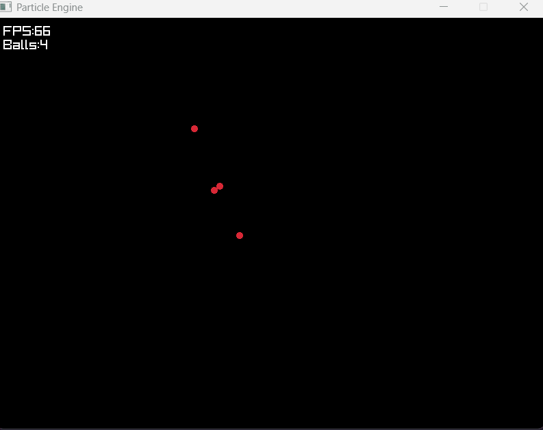
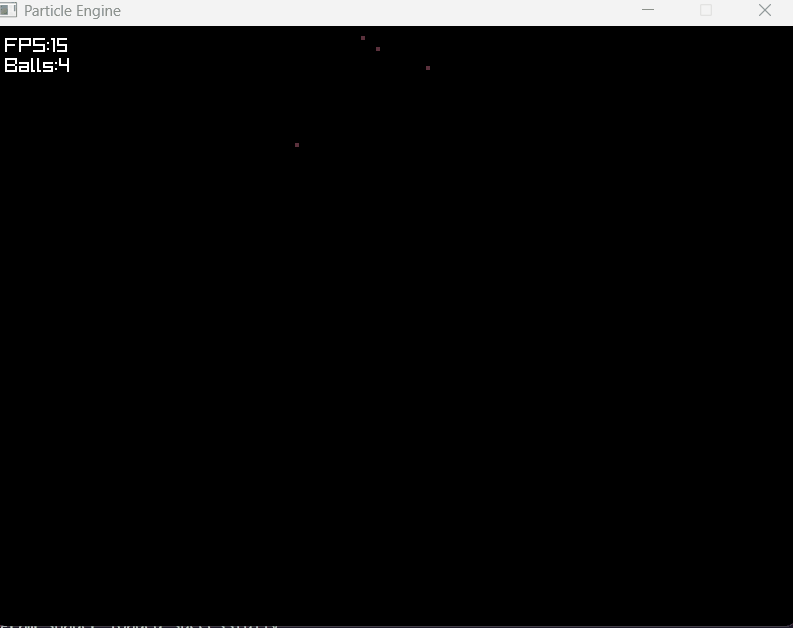
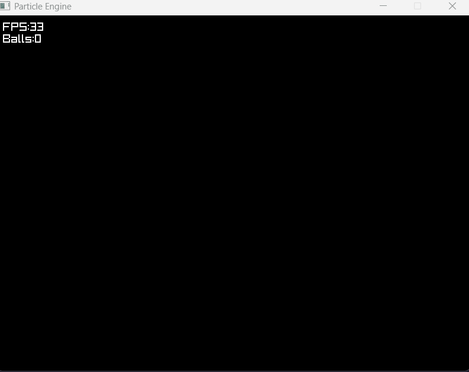

# This is my particle engine
Made using C++, I'm using this as a deep dive into simulation.
I aim to build on this further, eventually hoping to implement fluid simulation.

## Here is my first simulation, V1:

### Performance with -0
- 60 fps at 500 balls
- 30 fps at 900 balls

### Performance with -02
- 60 fps at 1100 balls
- 30 fps at 3000 balls

### Details
- Uses Verlet Integration
- Naive collisions, tested for every ball every second (n^2)
- Tested on a £300 school laptop with a browser and IDE also open.

## Here is my second simulation, V2:

### Performance with -02
- 60 fps at 650 balls
- 30 fps at 1450 balls
 
### Details
- Same as v1
- Now has damping to stop ball piles conserving energy causing waving
- Now uses substeps (4 substeps per frame in the gif) to create more accurate physics and stop trampolining when high velocity balls hit piles

## Here is my third, V3:

### Performance with -02
- 60 fps at 1450 balls
- 30 fps at 4440 balls
 
### Details
- Same as v1
- ball collision overhauled to work on only 2 particles rather than all
- Spatial hashing added to only compute collisions between particles in 9 closest possible places (massive performance boost)

# Thoughts
 - Spatial hashing especially useful for larger numbers of balls. Collision checks stay linear now (O(n) probably about 9n), whereas before they were exponential as every ball checked collisions with every other ball, but now its around 8 at most.
 - Spatial hashing was by far the hardest implementation; thinking about, and coding to find 9 closest locations within the spatial Grid was very complicated.
 - I expected its benefit to be larger. Especially the ball amount of 30 fps, considering that its benefit over naive collisions is larger for higher numbers of balls O(n^2) compared to O(n) with a chunky bit of overhead.
 - In all simulations so far, the max balls at 30 fps is usually about 3x that at 60fps. The largest being V3 at around 3.06x, the lowest being V2 at 2.23x. I infer this is from the processing complexity of doing spatial hashing over naive collisions.
 - Fps in v2 and v3 would be much higher, most likely 4x higher if it wasnt at the compromise of substeps, which makes physics more stable and realistic, but mean almost 4x the computation and spatial hashing, ball collisions and verlet integration are repeated 4x every frame.
 - My favourite part of this so far has been observing the visual difference of using smarter logic like verlet over euler and spatial hashing. 
 - The most satisfying part was when i identified this problem: Fast particles hitting a bed of other particles would trampoline back up, with almost all momentum conserved, whereas slow particles settled realistically. I realised this must be because the faster balls travel so quick that they travel very far into the pile in a single frame because of their velocity, and since rebound is proportional to ball overlap, it caused the balls to bounce back further than they should. This is how i learnt about the benefit of substepping.
